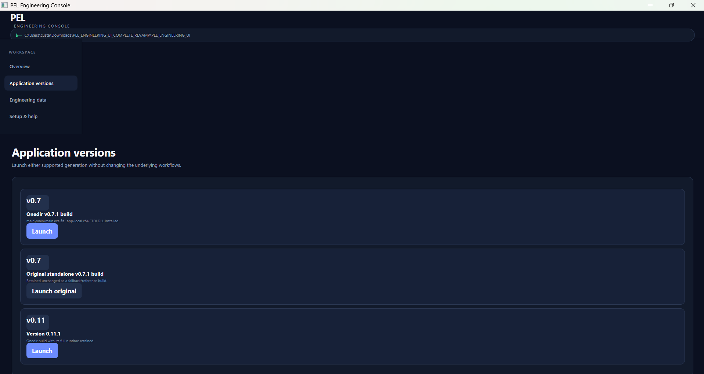
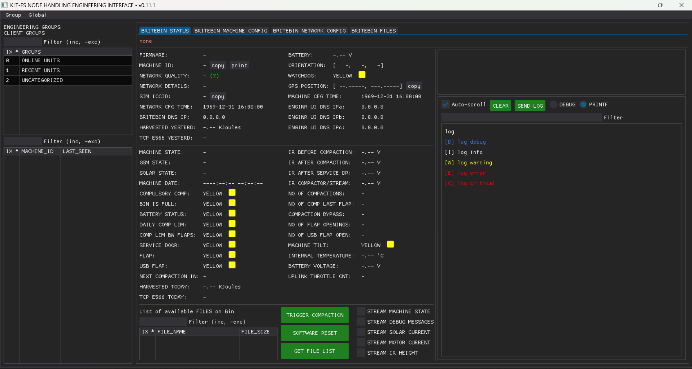
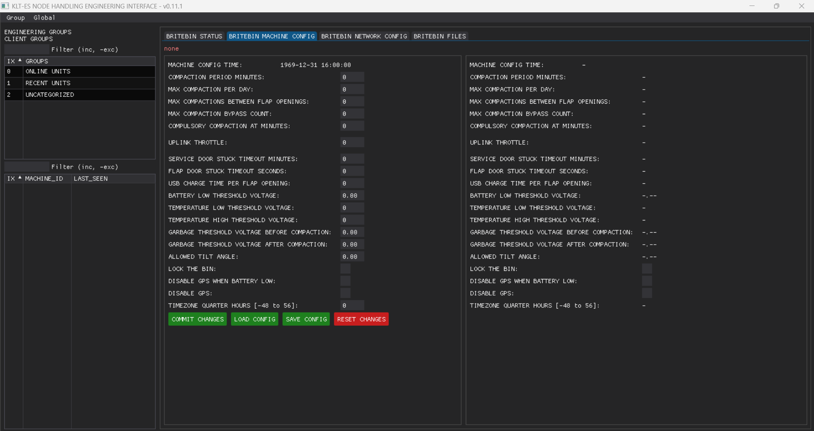
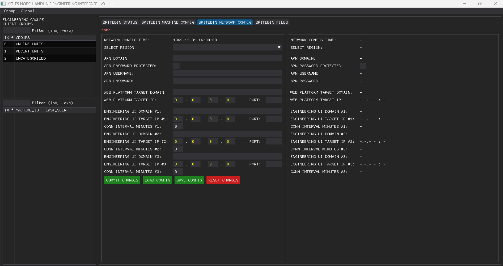
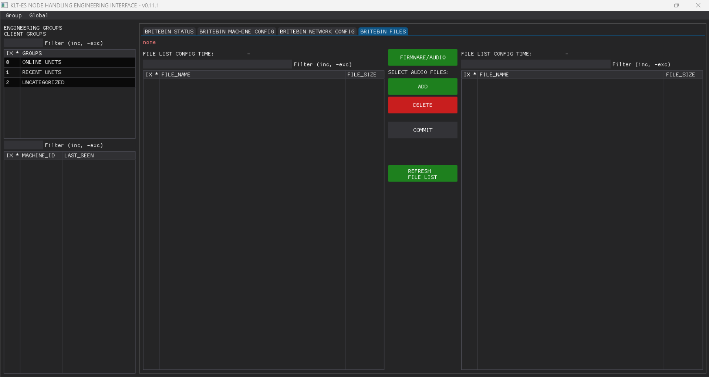

# PEL Engineering UI

PEL Engineering UI is a Windows software package used to support the setup, configuration and maintenance of PEL PCB units.

It brings together engineering applications and files associated with individual units, including configuration settings, groups of units, audio files and firmware. A central console provides access to these resources and lets an operator open either of the two included application versions depending on the PCB model.

## Purpose

The software is intended for engineers and technical support staff responsible for PEL PCBs.

Its main purpose is to keep the information and tools needed to work with those units in one place. Rather than locating separate application versions and data folders manually, an operator can start from the Engineering Console.

The package contains the existing engineering applications.

  

<table>
  <tr>
    <td align="center" width="50%">
      
       
      <b>Engineering Console</b>
    </td>
    <td align="center" width="50%">
      
       
      <b>Tabs</b>
    </td>
  </tr>
</table>
<table>
  <tr>
    <td align="center" width="50%">
      
       
      <b>More Tabs</b>
    </td>
    <td align="center" width="50%">
      
       
      <b>More Tabs</b>
    </td>
  </tr>
</table>

## Main functions

| Function | What it does |
| --- | --- |
| **Unit records** | Stores separate folders for individual units, including machine, network and file-related settings. |
| **Groups** | Holds definitions that organize units by site, test environment or other grouping. |
| **Firmware files** | Keeps firmware images available for engineering work. Firmware installation requires the appropriate tools and procedures. |
| **Audio files** | Keeps WAV and MP3 audio resources associated with the system. |
| **Application launcher** | Opens the included v0.7.1 or v0.11.1 engineering application. |
| **System overview** | Shows how many unit folders, groups, audio files and firmware files are present. |
| **Basic checks** | Checks that key application files are present. An optional diagnostic tool can also identify missing configuration files and certain file problems. |

## How it operates

1. An engineer starts the **PEL Engineering Console** on a Windows computer.
2. The console shows the available units, groups, audio resources and firmware files.
3. The engineer can open the relevant data folder or launch the engineering application version required for the job.
4. Work with an individual PCB or connected device is carried out using the selected application and established engineering procedures.

## Included applications

### Engineering Console

The standard console is a Windows-based starting screen. It provides an overview, links to the main data folders, quick access to both application versions and basic installation checks.

An optional Python-based console is also included. It offers a searchable list of units and more detailed, read-only checks of configuration, audio and firmware files.

### PEL Engineering UI v0.7.1 and v0.11.1

Both versions are supplied as compiled Windows applications. They can be launched through the console or directly through their own start files.

## Installation and starting the software

1. Extract the software package on a Windows PC.
2. Find the inner `PEL_ENGINEERING_UI` folder and place it at `C:\PEL_ENGINEERING_UI`.
3. Open that folder and run `START_PEL_CONSOLE.bat`.
4. Use the console to choose the appropriate application version.

The recommended folder location is important because the older applications contain references to `C:\PEL_ENGINEERING_UI`.

If the console is blocked by the PC's security settings, the applications can be started directly using:

- `START_V0.7.bat`
- `START_V0.11.bat`

The package includes FTDI driver files for compatible USB-connected hardware. Drivers may need to be installed separately before working with such hardware.

## Main folders

| Folder | Contents |
| --- | --- |
| `UNITS` | Individual unit records and configuration files. |
| `GROUPS` | Unit group definitions. |
| `AUDIO_FILES` | Audio resources. |
| `FIRMWARE_IMAGESDean` | Firmware images supplied in the package. |
| `PEL_CONSOLE` | Engineering Console and supporting files. |
| `CDM-v2.12.36.4-WHQL-Certified` | FTDI Windows driver package. |

